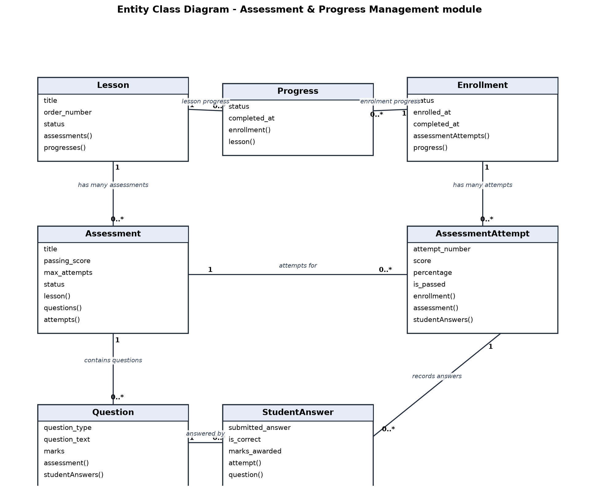

# Section 3 – Entity Classes

**Module:** Assessment & Progress Management
**Member:** OOI JIAN XIN

The entities that belong to the **Assessment & Progress Management** module are
`Assessment`, `Question`, `AssessmentAttempt`, `StudentAnswer` and `Progress`.
They are built with the **Eloquent ORM**, so each entity is a model class that
represents a database table, and the relationships between entities are modelled
as **object references** – Eloquent relationship methods that return the related
model or a collection of models – rather than by treating foreign keys as the
relationship itself. This section describes each entity, its purpose, its main
attributes, and how its relationships are represented in code. The related
`Lesson` and `Enrollment` entities are also shown because the entities of this
module associate with them.

---

## 3.1 Assessment

**Purpose.** An `Assessment` represents a test that is attached to a lesson of a
course. A student who is enrolled in the course may attempt the assessment, and
it holds the configuration that controls that attempt: the passing score, the
optional time limit and the maximum number of attempts allowed. It is used
throughout the module – by mentors and admins when managing assessments, by
students when taking them, and by the analytics service when producing
statistics.

**Main attributes** (from `$fillable`): `title`, `slug`, `description`,
`passing_score`, `time_limit`, `max_attempts` and `status`.

**Relationships.** An assessment belongs to the lesson that it tests
(`belongsTo Lesson`), and it can contain many questions and receive many
attempts (`hasMany Question` and `hasMany AssessmentAttempt`). These are
declared as object references in `app/Models/Assessment.php`:

```php
// app/Models/Assessment.php
public function lesson(): BelongsTo
{
    return $this->belongsTo(Lesson::class);
}

public function questions(): HasMany
{
    return $this->hasMany(Question::class);
}

public function attempts(): HasMany
{
    return $this->hasMany(AssessmentAttempt::class);
}
```

---

## 3.2 Question

**Purpose.** A `Question` is a single question that belongs to an assessment.
SkillBridge supports three types – multiple choice (MCQ), true/false and short
answer – so the entity stores the question text, the type, the correct answer
and, for a multiple-choice question, the options. Each question carries its own
marks and display order.

**Main attributes** (from `$fillable`): `question_text`, `question_type`,
`option_a`, `option_b`, `option_c`, `option_d`, `correct_answer`, `explanation`,
`marks` and `order_number`.

**Relationships.** A question belongs to the assessment it is part of
(`belongsTo Assessment`) and can be answered many times across different
attempts (`hasMany StudentAnswer`). Declared in `app/Models/Question.php`:

```php
// app/Models/Question.php
public function assessment(): BelongsTo
{
    return $this->belongsTo(Assessment::class);
}

public function studentAnswers(): HasMany {
    return $this->hasMany(StudentAnswer::class);
}
```

---

## 3.3 AssessmentAttempt

**Purpose.** An `AssessmentAttempt` records one attempt that a student (through
their enrollment) makes at an assessment. It captures the attempt number, the
raw score, the percentage, whether the student passed, and the times the attempt
was started and submitted. It is the entity that automatic grading updates when
a student submits.

**Main attributes** (from `$fillable`): `attempt_number`, `score`, `percentage`,
`is_passed`, `started_at` and `submitted_at`.

**Relationships.** An attempt belongs to the enrollment of the student who took
it (`belongsTo Enrollment`) and to the assessment being attempted
(`belongsTo Assessment`), and it is made up of many individual answers
(`hasMany StudentAnswer`). Declared in `app/Models/AssessmentAttempt.php`:

```php
// app/Models/AssessmentAttempt.php
public function enrollment(): BelongsTo
{
    return $this->belongsTo(Enrollment::class);
}

public function assessment(): BelongsTo
{
    return $this->belongsTo(Assessment::class);
}

public function studentAnswers(): HasMany
{
    return $this->hasMany(StudentAnswer::class, 'attempt_id');
}
```

---

## 3.4 StudentAnswer

**Purpose.** A `StudentAnswer` stores the answer a student submitted for one
question within one attempt, together with whether that answer was correct and
how many marks were awarded. One `AssessmentAttempt` therefore contains many
`StudentAnswer` records – one per question answered.

**Main attributes** (from `$fillable`): `submitted_answer`, `is_correct` and
`marks_awarded`.

**Relationships.** An answer belongs to the attempt it was submitted in
(`belongsTo AssessmentAttempt`, through `attempt_id`) and to the question it
answers (`belongsTo Question`). Declared in `app/Models/StudentAnswer.php`:

```php
// app/Models/StudentAnswer.php
public function attempt(): BelongsTo
{
    return $this->belongsTo(AssessmentAttempt::class, 'attempt_id');
}

public function question(): BelongsTo
{
    return $this->belongsTo(Question::class);
}
```

---

## 3.5 Progress

**Purpose.** A `Progress` record tracks whether a student has completed a lesson
of a course within a specific enrollment. When a student passes a lesson's
assessment, the module automatically creates (or updates) a `Completed` progress
record for that lesson, which drives the student's "My Progress" page.

**Main attributes** (from `$fillable`): `status` (e.g. `Completed`) and
`completed_at`.

**Relationships.** A progress record belongs to the enrollment it belongs to
(`belongsTo Enrollment`) and to the lesson it tracks (`belongsTo Lesson`).
Declared in `app/Models/Progress.php`:

```php
// app/Models/Progress.php
public function enrollment(): BelongsTo
{
    return $this->belongsTo(Enrollment::class);
}

public function lesson(): BelongsTo
{
    return $this->belongsTo(Lesson::class);
}
```

---

## 3.6 Entity Class Diagram

The relationships between the entities of this module – together with the
related `Lesson` and `Enrollment` entities that the assessment data attaches to –
are shown in Figure 3.1. The diagram follows the object-reference view required
by the assignment: the classes are connected by associations with their
cardinalities (for example, one `Lesson` has many `Assessment` records, and one
`Assessment` has many `Question` and `AssessmentAttempt` records), and each
association corresponds to the Eloquent relationship method shown in the code
snippets above. No foreign-key column is treated as the relationship itself;
instead, each class references its related objects through these methods.



The associations shown are:

| From (one) | To (many) | Relationship method |
| --- | --- | --- |
| `Lesson` | `Assessment` | `Lesson::assessments()` / `Assessment::lesson()` |
| `Lesson` | `Progress` | `Lesson::progresses()` / `Progress::lesson()` |
| `Enrollment` | `Progress` | `Enrollment::progress()` / `Progress::enrollment()` |
| `Enrollment` | `AssessmentAttempt` | `Enrollment::assessmentAttempts()` / `AssessmentAttempt::enrollment()` |
| `Assessment` | `Question` | `Assessment::questions()` / `Question::assessment()` |
| `Assessment` | `AssessmentAttempt` | `Assessment::attempts()` / `AssessmentAttempt::assessment()` |
| `AssessmentAttempt` | `StudentAnswer` | `AssessmentAttempt::studentAnswers()` / `StudentAnswer::attempt()` |
| `Question` | `StudentAnswer` | `Question::studentAnswers()` / `StudentAnswer::question()` |
