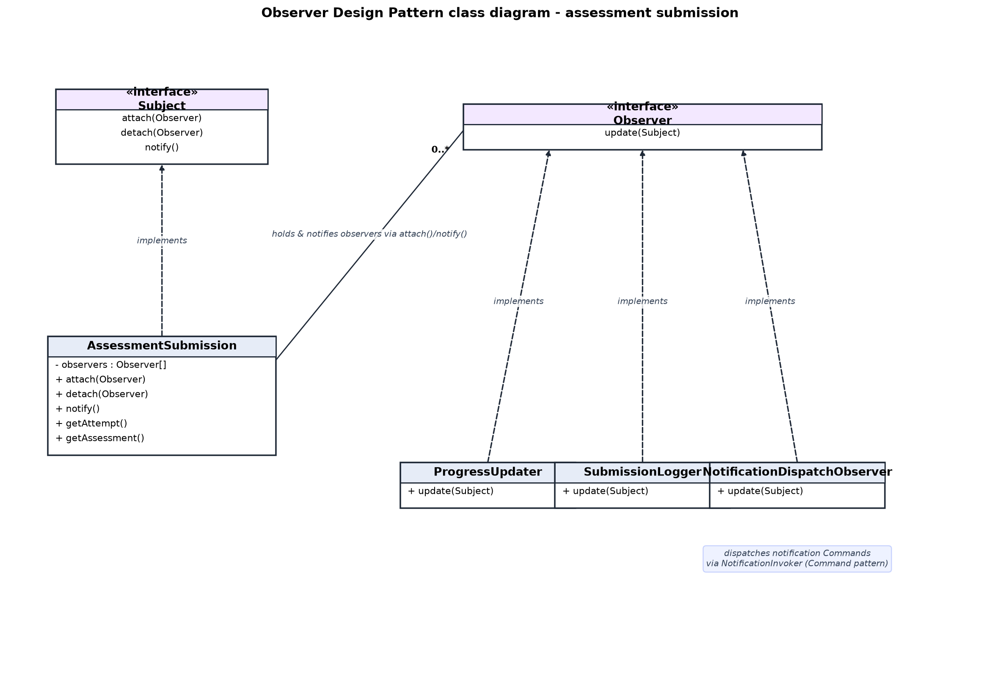

# Section 4 – Observer Design Pattern

**Module:** Assessment & Progress Management
**Member:** OOI JIAN XIN

---

## 4.1 Description of the Design Pattern

The **Observer** pattern is one of the behavioural design patterns described by
the Gang of Four (Gamma et al., 1995). It defines a **one-to-many dependency**
between objects so that when one object changes state, all of the objects that
depend on it are **notified and updated automatically**.

The pattern has four roles:

- **Subject** – an interface that lets observers subscribe and unsubscribe.
  It declares `attach()`, `detach()` and `notify()`.
- **Concrete Subject** – the object whose state changes. It keeps a list of
  registered observers and, in `notify()`, calls `update()` on every observer in
  that list.
- **Observer** – an interface with a single `update()` method that subjects
  call when their state changes.
- **Concrete Observer** – a class that implements `Observer` and performs its
  own reaction inside `update()` when it is notified.

The key property of the pattern is **decoupling**: the subject knows its
observers only through the `Observer` interface, so it never needs to know what
the observers actually do or how many of them exist.

The Observer pattern is well suited to the Assessment & Progress Management
module because **submitting an assessment is a single event with several
independent consequences**. When a student submits an assessment, the graded
attempt must (1) update the student's lesson progress, (2) write an audit-log
entry, and (3) trigger notifications. These are separate responsibilities that
should not be hard-coded inside the grading logic. The Observer pattern lets the
grading code publish one event and lets each reaction subscribe to it
independently.

---

## 4.2 Implementation of the Design Pattern

All the classes of the pattern live under `app/Patterns/Observer/`:

| Role | Class | Path |
| --- | --- | --- |
| Subject (interface) | `Subject` | `app/Patterns/Observer/Subject.php` |
| Observer (interface) | `Observer` | `app/Patterns/Observer/Observer.php` |
| Concrete Subject | `AssessmentSubmission` | `app/Patterns/Observer/AssessmentSubmission.php` |
| Concrete Observer | `ProgressUpdater` | `app/Patterns/Observer/Observers/ProgressUpdater.php` |
| Concrete Observer | `SubmissionLogger` | `app/Patterns/Observer/Observers/SubmissionLogger.php` |
| Concrete Observer | `NotificationDispatchObserver` | `app/Patterns/Observer/Observers/NotificationDispatchObserver.php` |

### The two interfaces

`Subject` declares the three operations that any subject must provide so that
observers can register, unregister and be notified:

```php
// app/Patterns/Observer/Subject.php
interface Subject
{
    public function attach(Observer $observer): void;
    public function detach(Observer $observer): void;
    public function notify(): void;
}
```

`Observer` declares the single method that subjects use to notify their
dependents:

```php
// app/Patterns/Observer/Observer.php
interface Observer
{
    public function update(Subject $subject): void;
}
```

### The Concrete Subject – AssessmentSubmission

`AssessmentSubmission` is the concrete subject. It wraps the **graded attempt**
and its **assessment**, keeps a list of registered observers, and, when
`notify()` is called, iterates that list and calls `update($this)` on each
observer through the `Observer` interface:

```php
// app/Patterns/Observer/AssessmentSubmission.php
class AssessmentSubmission implements Subject
{
    protected array $observers = [];

    public function __construct(
        protected AssessmentAttempt $attempt,
        protected Assessment $assessment
    ) {
    }

    public function attach(Observer $observer): void
    {
        if (!in_array($observer, $this->observers, true)) {
            $this->observers[] = $observer;
        }
    }

    public function detach(Observer $observer): void
    {
        $this->observers = array_values(array_filter(
            $this->observers,
            fn (Observer $registered) => $registered !== $observer
        ));
    }

    public function notify(): void
    {
        foreach ($this->observers as $observer) {
            $observer->update($this);
        }
    }

    public function getAttempt(): AssessmentAttempt { return $this->attempt; }
    public function getAssessment(): Assessment { return $this->assessment; }
}
```

### The Concrete Observers

**ProgressUpdater** reacts only when the attempt was **passed**: it marks the
lesson (to which the assessment belongs) as `Completed` in the student's
progress record through Eloquent's `updateOrCreate`, scoped by the enrollment
and the lesson:

```php
// app/Patterns/Observer/Observers/ProgressUpdater.php
class ProgressUpdater implements Observer
{
    public function update(Subject $subject): void
    {
        if (!$subject instanceof AssessmentSubmission) {
            return;
        }

        $attempt = $subject->getAttempt();

        // Only a passing submission completes the linked lesson.
        if (!$attempt->is_passed) {
            return;
        }

        Progress::updateOrCreate(
            [
                'enrollment_id' => $attempt->enrollment_id,
                'lesson_id' => $subject->getAssessment()->lesson_id,
            ],
            [
                'status' => 'Completed',
                'completed_at' => now(),
            ]
        );
    }
}
```

**SubmissionLogger** writes an audit record to the dedicated `assessment` log
channel for every submission. It deliberately records only non-sensitive data
(assessment, attempt, student, score, percentage, pass/fail and a timestamp):

```php
// app/Patterns/Observer/Observers/SubmissionLogger.php
class SubmissionLogger implements Observer
{
    public function update(Subject $subject): void
    {
        if (!$subject instanceof AssessmentSubmission) {
            return;
        }

        $attempt = $subject->getAttempt();
        $assessment = $subject->getAssessment();

        Log::channel('assessment')->info('Assessment submitted', [
            'assessment_id' => $assessment->id,
            'assessment_title' => $assessment->title,
            'attempt_id' => $attempt->id,
            'student_id' => $attempt->enrollment?->student_id,
            'score' => $attempt->score,
            'percentage' => $attempt->percentage,
            'is_passed' => $attempt->is_passed,
            'timestamp' => now()->toIso8601String(),
        ]);
    }
}
```

**NotificationDispatchObserver** reacts by composing the **Command pattern**
(used by the Notification module): it builds and runs the notification commands
that inform the student of their result and the mentor that an assessment was
submitted, using the `NotificationInvoker`:

```php
// app/Patterns/Observer/Observers/NotificationDispatchObserver.php
class NotificationDispatchObserver implements Observer
{
    public function update(Subject $subject): void
    {
        if (!$subject instanceof AssessmentSubmission) {
            return;
        }

        $attempt = $subject->getAttempt();
        $assessment = $subject->getAssessment();

        $student = $attempt->enrollment?->student;
        $mentor = $assessment->lesson?->course?->mentor;

        $invoker = app(NotificationInvoker::class);
        $notifier = app(NotificationService::class);

        if ($student) {
            $invoker->run(new NotifyStudentOnAssessmentResult($notifier, $student, $assessment, $attempt));
        }

        if ($mentor && $student) {
            $invoker->run(new NotifyMentorOnAssessmentSubmission($notifier, $mentor, $student, $assessment));
        }
    }
}
```

### How the pieces are connected – `Student\AssessmentController::submit()`

The pattern is instantiated inside
`app/Http/Controllers/Student/AssessmentController.php`. After the attempt has
been **graded** (each answer compared with the correct answer, the score and
percentage computed, and the attempt marked as submitted), the controller creates
the concrete subject, **attaches the three observers**, and calls `notify()`:

```php
// app/Http/Controllers/Student/AssessmentController.php (submit())
$submission = new AssessmentSubmission($attempt, $assessment);
$submission->attach(new ProgressUpdater());
$submission->attach(new SubmissionLogger());
$submission->attach(new NotificationDispatchObserver());
$submission->notify();
```

### Execution flow

When a student submits an assessment, the following happens:

1. The student posts their answers to the assessment's `submit` route.
2. The controller checks that the student is enrolled and that the assessment
   is published, then finds the student's in-progress attempt.
3. Each answer is graded: the module creates a `StudentAnswer` for every
   question, computes the total score, the percentage and whether the attempt
   passed, and updates the `AssessmentAttempt`.
4. An `AssessmentSubmission` (the concrete subject) is created with the graded
   attempt and its assessment.
5. The three observers – `ProgressUpdater`, `SubmissionLogger` and
   `NotificationDispatchObserver` – are attached to the subject.
6. `notify()` is called. The subject calls `update($this)` on each observer
   through the `Observer` interface.
7. Each observer performs its own action:
   - `ProgressUpdater` marks the lesson as Completed when the attempt passed;
   - `SubmissionLogger` writes the "Assessment submitted" audit-log entry;
   - `NotificationDispatchObserver` dispatches the result/submission
     notification commands.
8. The student is redirected to the result page.

This is a **genuine implementation of the GoF Observer pattern**. The subject
maintains a real registry of observers with working `attach()` and `detach()`
methods, and it notifies every observer **through the `Observer` interface** in
a loop. The grading code does not call `ProgressUpdater` or `SubmissionLogger`
directly – it only calls `notify()`. Adding or removing a reaction therefore
never requires editing the submission logic; it only requires attaching (or not
attaching) an observer.

---

## 4.3 Class Diagram

Figure 4.1 shows the UML class diagram of the implementation. The `Subject` and
`Observer` interfaces appear at the top, with `AssessmentSubmission` implementing
`Subject` and the three concrete observers – `ProgressUpdater`,
`SubmissionLogger` and `NotificationDispatchObserver` – implementing `Observer`.
The association from `AssessmentSubmission` to `Observer` (labelled
`0..*`, "holds & notifies observers via attach()/notify()") shows that the
subject stores and notifies its observers through the interface. The note under
`NotificationDispatchObserver` shows that it connects the Observer pattern with
the Command pattern used by the Notification module.



The diagram shows:

- `Subject` (interface) with `attach`, `detach` and `notify`;
- `AssessmentSubmission` **implements** `Subject` and holds an
  `observers : Observer[]` list;
- `Observer` (interface) with `update(Subject)`;
- `ProgressUpdater`, `SubmissionLogger` and `NotificationDispatchObserver` all
  **implement** `Observer`;
- the subject's association to the observers through the `Observer` interface.

---

## 4.4 Justification

**The problem.** Before using the Observer pattern, every consequence of
grading an assessment submission would have had to be written directly into the
submission logic of `AssessmentController`. That method would have to update the
student's progress, write a log entry and send notifications, one after another,
in a single block of code.

**The coupling problem.** If those reactions were coded directly inside
`submit()`, the assessment logic would be tightly coupled to three unrelated
concerns: progress tracking, logging and notifications. The controller would
need to know about the `Progress` model, the `Log` facade and the notification
commands. Every time a new reaction was needed (for example, awarding a badge or
sending an email), the `submit()` method would have to be edited and re-tested,
and a change to one reaction could accidentally break the grading flow.

**How Observer solves it.** The Observer pattern separates the **grading
process** from its **side effects**. The grading code only creates the
`AssessmentSubmission` subject and calls `notify()`. It does not know – and does
not need to know – which observers are attached or what they do. Each reaction
lives in its own class with a single responsibility, and it subscribes to the
submission event through `attach()`.

**Extensibility.** Adding another reaction in the future is done by creating a
new class that implements `Observer` and attaching it alongside the existing
ones, for example:

```php
$submission->attach(new ProgressUpdater());
$submission->attach(new SubmissionLogger());
$submission->attach(new NotificationDispatchObserver());
$submission->attach(new NewReactionObserver()); // future reaction
```

The submission and grading logic in `submit()` does not change at all.

**Maintainability and separation of responsibilities.** Because each observer is
a small, self-contained class, the responsibilities are clearly separated:
progress is owned by `ProgressUpdater`, auditing by `SubmissionLogger`, and
notifications by `NotificationDispatchObserver`. Each can be understood, tested
and changed in isolation, which makes the module easier to maintain. This is
reflected in the test suite, where the observer behaviour (lesson completed on
pass, submission logged, notifications dispatched) is verified independently.

**Integration with the Command pattern.** The design also shows how patterns can
work together. The `NotificationDispatchObserver` does not send notifications
itself; inside its `update()` method it builds `NotifyStudentOnAssessmentResult`
and `NotifyMentorOnAssessmentSubmission` commands and hands them to the
`NotificationInvoker` of the Command pattern (used by the Notification module).
This keeps the Observer pattern focused on reacting to the submission event
while the Command pattern handles how each notification is executed, giving a
clean boundary between the Assessment & Progress module and the Notification
module.
