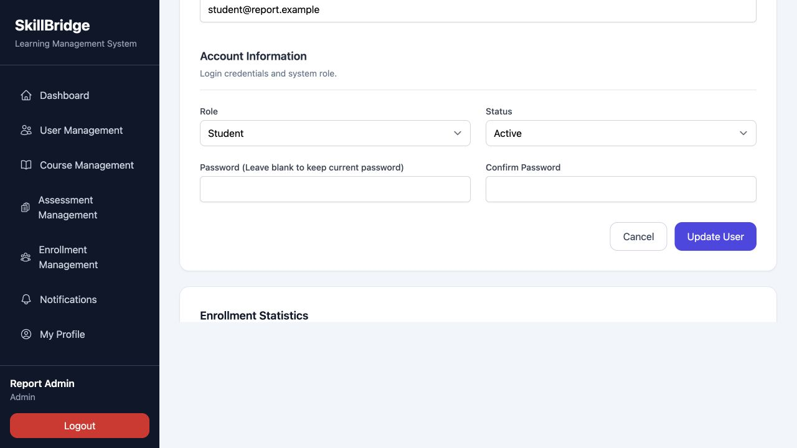
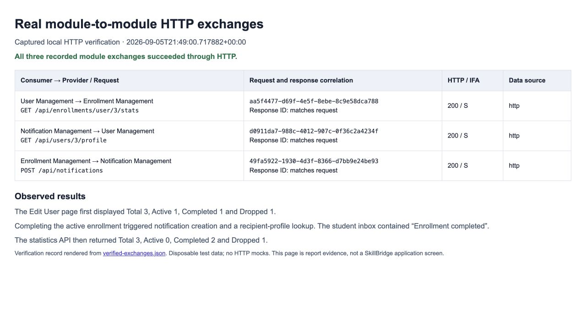
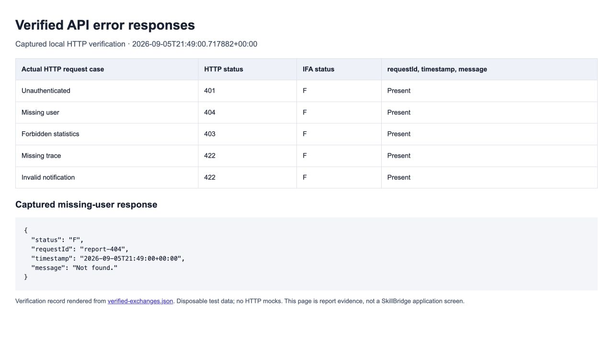

# Section 6 — exact report updates

The code fixes and local HTTP verification are complete. Apply the four edits below to your report. Keep your existing Tables 6.1–6.6 and Figures 6.1–6.2. Figure 6.2 should remain labelled as a mocked automated test.

## 1. Replace the text under 6.1 Overview

The User Management module both exposes and consumes JSON-based REST services. It exposes a user-profile service to Notification Management and consumes enrollment statistics from Enrollment Management. These interfaces use the project's Interface Agreement: requests include a timestamp or requestId, and responses include status and timestamp. The implementation also returns requestId to correlate each response with its request. S indicates success, F indicates a request failure, and E indicates a server error.

The user-profile and enrollment-statistics endpoints require an authenticated web session and apply a limit of 60 requests per minute. Shared API exception handling supplies the response fields for authentication, validation, missing-resource and other framework errors. Section 6.5 records the specific success and failure cases verified locally.

## 2. Update the client code example in 6.3

Replace the old `userStats()` code example with the method in `enrollment-stats-code.txt`, supplied in this folder. It now includes a request identifier that is retained for logging and records whether the result came from HTTP or the database fallback. Keep the surrounding service tables and Figure 6.2.

## 3. Replace all text under 6.4 Module Integration and Failure Handling

The User Management module participates in two service relationships. It exposes a user-profile service consumed by Notification Management and consumes the enrollment-statistics service provided by Enrollment Management.

When an Administrator opens the Edit User page, Admin\UserController::edit() calls EnrollmentStatsClient::userStats(). The client requests the selected user's enrollment statistics through GET /api/enrollments/user/{user}/stats. After checking for HTTP 200 and an IFA status of S, it returns the response data to the controller. The view displays Total, Active, Completed and Dropped enrollment counts.

Notification Management invokes UserProfileClient while processing notification creation through its API. The client calls GET /api/users/{user}/profile and supplies the returned account information to the Notification module, which resolves the recipient's display name. In the verified workflow, completing an enrollment caused Enrollment Management to call the notification API, which then consumed the user-profile service before creating the notification.

The clients send timestamp and requestId fields. The shared InternalHttp concern configures a five-second timeout and requests JSON responses. It forwards the original encrypted session cookie from the incoming Cookie header so that the receiving module can authenticate the same caller. The CSRF token is also forwarded for protected write requests. Outbound requests are restricted to the configured application origin, and automatic redirects are disabled.

The clients check the HTTP status and IFA status before using returned data. If a request fails, they log the failure and attempt their existing local database fallback. This supports continuity when an internal service is unavailable. A dedicated service-exchange log records the endpoint, request identifier, HTTP status, response status, response timestamp and data source. Its data_source field distinguishes http from database_fallback. The exchange log excludes credentials and personal profile fields.

API exceptions are formatted through ApiExceptionResponse and the shared Ifa helper. Request failures return F with their corresponding HTTP status, while unexpected server failures return E with a generic message. Responses include requestId and timestamp. Validation failures retain field-level errors, and relevant transport headers such as Retry-After are preserved. Browser authentication failures continue to redirect to the login page.

## 4. Replace all of 6.5, including the placeholder on the following page

Copy the following section, inserting the supplied images at the indicated figure positions. The captions below are ready to use.

### 6.5 Verification Evidence and Current Limitations

The updated implementation was verified on 6 September 2026 using a local PHP server with four workers and an isolated SQLite database containing disposable Administrator, Mentor and Student accounts. The verification used normal login, session authentication, CSRF protection and the existing application routes. No Http::fake() responses were used in this HTTP verification. The captured records use UTC timestamps; 5 September 2026 at 21:49 UTC corresponds to 6 September 2026 at 05:49 in Malaysia.

First, an Administrator opened the Edit User page for the demonstration Student. User Management called the Enrollment Management statistics endpoint and displayed Total 3, Active 1, Completed 1 and Dropped 1. The service-exchange record showed HTTP 200, IFA status S and data_source equal to http, with matching request and response identifiers. This confirms that the displayed data was obtained through HTTP in the verified operation.

Next, the Administrator completed the active enrollment. Enrollment Management called the Notification API, which requested the recipient's profile from the User Management API. Both module exchanges returned HTTP 200 and IFA status S, and both were recorded as http rather than database_fallback. The Student's notification page subsequently contained “Enrollment completed”. A further statistics request returned Total 3, Active 0, Completed 2 and Dropped 1. The Administrator Edit User page displayed these updated values, as shown in Figure 6.3.

**Figure 6.3.** Administrator Edit User page displaying the demonstration Student's enrollment statistics after completion of an active enrollment: Total 3, Active 0, Completed 2 and Dropped 1.

**Figure 6.4.** Captured local service-exchange records for enrollment-statistics consumption, user-profile consumption and notification creation. Each record shows HTTP 200, IFA status S, a matching request/response identifier and an HTTP data source. The figure is a rendered verification record rather than an application screen.

Error-response verification covered an unauthenticated profile request (401), a missing user (404), unauthorized access to another user's statistics (403), a request without timestamp or requestId (422), and an invalid notification payload (422). Each response contained status F, requestId, timestamp and message. The invalid notification response also retained its field-level validation errors. The missing-user response now uses F and includes the previously missing request identifier.

**Figure 6.5.** Results of five actual local HTTP error checks and the captured missing-user response, showing the IFA failure fields. The figure is rendered from the saved verification results.

Automated regression checks also passed: 75 tests with 293 assertions across the selected API, service-consumption, authentication, single-session and security test files. These include controlled tests for rate-limit error formatting and preservation of Retry-After, sanitised server errors, and restrictions on internal credential forwarding. Figure 6.2 remains evidence of response handling with a mocked HTTP client; Figures 6.3–6.5 provide the additional local HTTP evidence.

The verification demonstrates the tested module workflows and error responses in the local environment. It does not establish production deployment, load capacity or the behavior of every possible infrastructure failure. The application URL must match the intended internal service origin, and the server must support concurrent requests for these nested HTTP calls. Database fallback remains available, so a populated screen alone is insufficient evidence of successful HTTP communication. Trace fields are checked for presence; strict UUID and ISO 8601 input-format validation is not claimed.

---

After pasting, refresh the table of contents and figure numbering. Remove the old statements that HTTP integration has not been demonstrated or that the tested 401/404 responses are still missing IFA fields. Delete the instruction beginning “[Insert real module-to-module request and response evidence…]”.

The report PDF itself has not been edited. The text above describes verified local behavior; it should not be changed to claim a production test.
